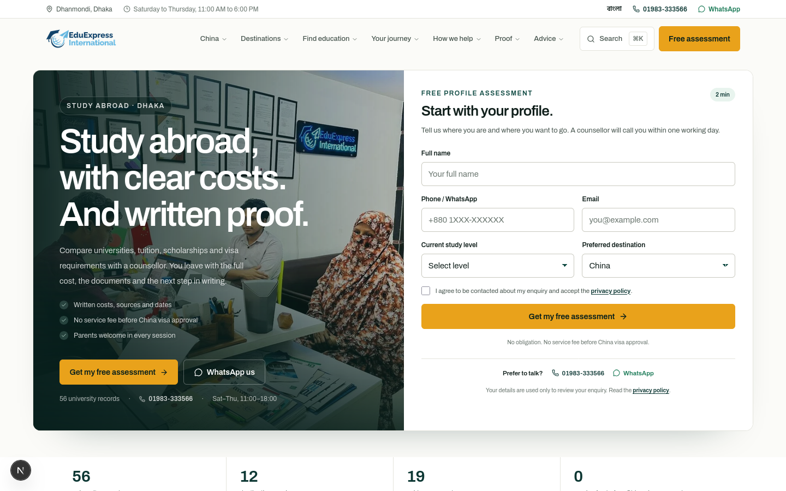
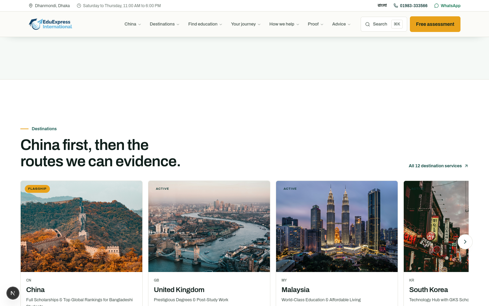
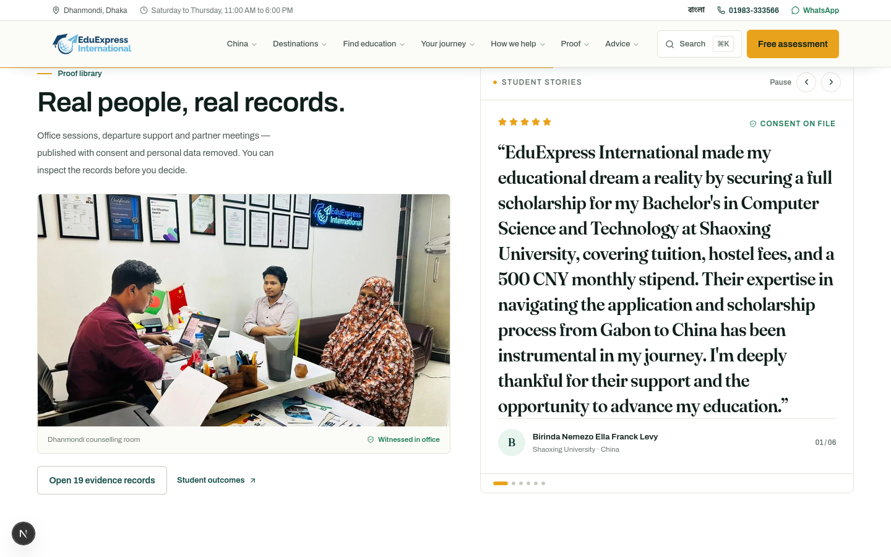
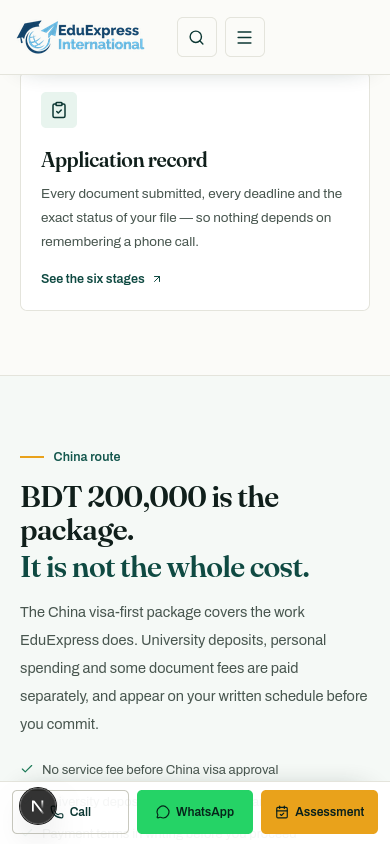
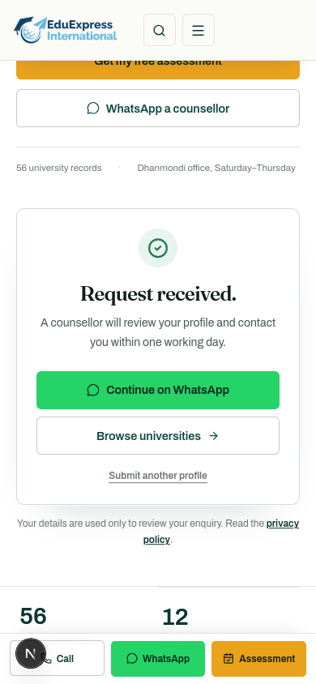

# Home redesign — near-white lead-generation UI

**Date:** 29 October 2026
**Scope:** `src/app/page.tsx`, `src/components/home/HomeHero.tsx`, `HomeLeadForm`, `MobileLeadBar`, `Carousel`, `TestimonialCarousel`, `src/components/LightHeader.tsx`, `src/app/globals.css`, `tailwind.config.js`.
**Skill:** global at `~/.agents/skills/eduexpress/SKILL.md`; mirrored at `.agents/skills/eduexpress/SKILL.md`.

## Direction

A near-white, photo-led admissions page built around one job: **capture a profile assessment request**. White and `#fbfbf8` grounds, deep petrol-green type, one marigold action colour, thin `#e4e4dc` rules, 8–16px cards. A split hero pairs a real Dhanmondi counselling photograph with an embedded form. **Archivo carries the home headlines and UI**; Fraunces appears only as the pull-quote accent. Body copy at 13.5–16px with generous leading for easy reading.

## Page order

1. **Hero:** split photo/counselling room panel with “Study abroad, with clear costs. And written proof.” + trust points + CTAs; embedded **lead form** (`#assessment`) on the right.
2. **Fact strip:** 56 university records, 12 destination services, 19 evidence records, 0 service fee before China visa approval.
3. **What you get:** recognition check, cost schedule, application record.
4. **China package:** BDT 200,000, included vs paid separately, payment CTA.
5. **Destinations carousel:** photo slides for verified destinations, designed gradient tiles for the rest; China/UK/Malaysia/South Korea first.
6. **Six-stage journey.**
7. **Proof + student stories carousel:** office photo and auto-advancing quotes with pause, arrows and dots.
8. **Dated guides, FAQ, final assessment CTA + Dhanmondi office card.**
9. **Mobile lead bar:** Call / WhatsApp / Assessment, appears after the hero and hides over the form and footer.

## Lead generation

- Hero form fields: full name, phone/WhatsApp, email, current study level, preferred destination, explicit privacy consent. Honeypot field included.
- POST `/api/leads` with `source: homepage_lead_form`, `leadType: assessment`, consent version/timestamp, UTM parameters, landing page, Meta event id and optional tracking consent.
- Success state confirms a one-working-day callback and offers WhatsApp + browse universities + submit another profile.
- Header “Free assessment” anchors to the form on `/` and keeps linking to `/education-fit-assessment` elsewhere.
- Floating WhatsApp widget is hidden on `/`; the page uses the hero/form links, the closing CTA and the mobile lead bar instead.
- Tracking: `trackAssessmentSubmit` after success.

## Motion & carousels

- Hero: photo scale settle, masked three-line headline rise, staggered trust copy, form entrance.
- Thin marigold scroll-progress line under the fixed header.
- Destination carousel: native scroll-snap with arrows (desktop), progress bar, “Swipe or drag” hint; image zoom on hover.
- Testimonial carousel: horizontal slide/fade via `AnimatePresence`; auto-advances every 9 seconds only while in view; pauses on hover, and has a visible Pause/Play control; manual arrows and dots.
- Reduced motion disables auto-advance, ticker-like movement and smooth jumps; all content is visible without animation.
- No scroll-reveal opacity wrappers that can hide content; sections render immediately.

## Verification

- `npx tsc --noEmit` clean.
- `npm run lint` 0 errors (51 pre-existing repo warnings).
- `npm run build` successful; 169/169 static pages.
- Playwright at 1440, 1024, 390 and 360: no horizontal page scroll; hero form anchors correctly; carousel arrows advance; testimonial auto-advance and pause verified; reduced-motion state stops auto motion; 0 console errors/warnings.
- Form submission UI verified with a mocked `POST /api/leads` response (no test lead written to the database).

## Screenshots

